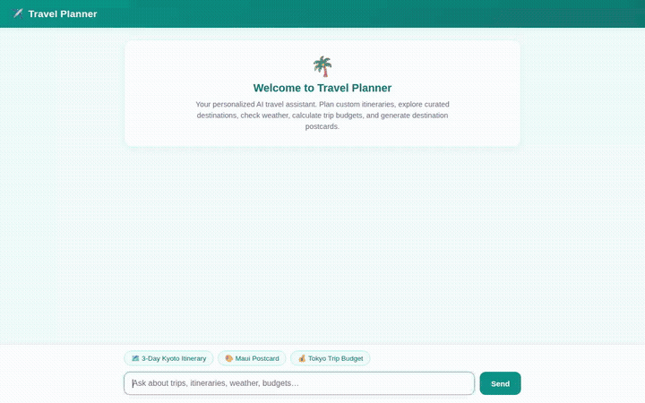

# Travel Planner Agent ✈️

An intelligent, multi-turn travel planning assistant built with the Google Agent Development Kit (ADK) and powered by `gemini-2.5-flash`. The agent creates personalized multi-day itineraries, looks up curated destinations, checks live weather and time zones, converts currencies, geocodes addresses, finds nearby places, generates custom visual postcards and travel videos, and preserves traveler allergies and preferences across conversations.



---

## ✨ Features & Implemented Capabilities

Every capability listed below is wired and operational in the codebase (`app/agent.py`):

- **Long-Term Memory across Sessions (Vertex AI Memory Bank)**
  - Preloads remembered facts, dietary restrictions, and allergies before each conversation turn via `PreloadMemoryTool`.
  - Persists traveler preferences and allergies after each turn via `add_session_to_memory()` callback.
  - Cross-checks all food, dining, and activity recommendations against remembered user allergies.

- **Destination Catalog & Search (Google Cloud Firestore)**
  - `list_destinations`: Streams the curated catalog of global destinations from Firestore.
  - `search_destinations`: Real-time keyword filtering across destination names, countries, vibes, descriptions, and attractions.
  - `get_destination_details`: Fetches full metadata (best seasons, estimated budget tier, currency, coordinates) for a specific spot.
  - `add_destination`: Allows dynamically adding new travel spots directly to the Firestore collection.

- **Real-Time Travel Tools**
  - `get_weather`: Live temperature, weather condition, wind speed, and humidity via the Open-Meteo API.
  - `get_current_time`: Precise local time and UTC offsets using `zoneinfo.ZoneInfo`.
  - `convert_currency`: Accurate exchange rate conversions via the Frankfurter API.
  - `geocode_address`: Forward geocoding of addresses and landmarks to GPS coordinates using the Google Maps Geocoding API.
  - `find_nearby_places`: Discovers nearby restaurants, cafes, tourist attractions, and lodging using the Google Places API.

- **Postcard & Video Generation (Google Cloud Storage & Vertex AI)**
  - `generate_destination_image`: Produces stylized travel illustrations and postcards using `gemini-3.1-flash-lite-image`. Saves the image to the session's artifacts panel and uploads it to Google Cloud Storage to return a public HTTPS URL.
  - `generate_destination_video`: Generates short cinematic travel clips using Google's Omni model (`gemini-omni-flash-preview`) in the global region. Saves the video artifact to the session context and uploads the MP4 bytes directly to Google Cloud Storage.

- **Secure Python Execution (Agent Engine Sandbox)**
  - `sandbox_code_executor`: Runs Python data processing and budget calculations in an isolated Agent Engine Sandbox Code Executor.

- **Rich UI Cards (A2UI)**
  - Formats structured recommendations as A2UI JSON cards via catalog schema and `a2ui_callback`.

---

## 🏗️ Architecture

```
                                 ┌───────────────────────────────┐
                                 │       Traveler Client         │
                                 │   (FastAPI Chat UI / A2A)     │
                                 └──────────────┬────────────────┘
                                                │ A2A Protocol
                                                ▼
┌─────────────────────────────────────────────────────────────────────────────┐
│                       Travel Planner ADK Agent                              │
│                                                                             │
│   ┌─────────────────────┐   ┌─────────────────────┐   ┌─────────────────┐   │
│   │  PreloadMemoryTool  │   │  gemini-2.5-flash   │   │  A2UI Callback  │   │
│   └──────────┬──────────┘   └──────────┬──────────┘   └─────────────────┘   │
└──────────────┼─────────────────────────┼────────────────────────────────────┘
               │                         │
       ┌───────┴──────┐       ┌──────────┴──────────┐
       │              │       │                     │
       ▼              ▼       ▼                     ▼
┌──────────────┐ ┌──────────────┐ ┌──────────────────┐ ┌────────────────────┐
│  Vertex AI   │ │  Cloud       │ │  Vertex AI GenAI │ │ Google Maps &      │
│  Memory Bank │ │  Firestore   │ │  Image / Omni    │ │ Open-Meteo APIs    │
│  (Long-Term) │ │  (Catalog)   │ │  (Media & GCS)   │ │ (Weather/Places)   │
└──────────────┘ └──────────────┘ └──────────────────┘ └────────────────────┘
```

---

## 🚀 Getting Started Locally

### Prerequisites

- Python 3.11+
- [uv](https://docs.astral.sh/uv/) package manager
- Google Cloud SDK (`gcloud`) authenticated with your project:
  ```bash
  gcloud auth login
  gcloud auth application-default login
  gcloud config set project <your-project-id>
  ```

### 1. Install Dependencies

From the project root:

```bash
uv sync
```

### 2. Environment Configuration

Create a `.env` file in the project root:

```bash
GOOGLE_MAPS_API_KEY="your-api-key"
```


### 3. Run with ADK Playground

To test the agent and inspect tool calls, artifacts, and memories in the ADK Developer UI:

```bash
uv run agents-cli playground
```

### 4. Run the Custom Chat Web Frontend

The included lightweight FastAPI chat interface communicates over the A2A protocol:

```bash
cd frontend
python3 -m venv .venv
source .venv/bin/activate
pip install -r requirements.txt

export AGENT_ENGINE_RESOURCE_NAME="projects/<project-number>/locations/us-central1/reasoningEngines/<engine-id>"
export AGENT_DIRECTORY="app"
export PORT=8080

python main.py
```

Open a browser and navigate to the local port configured in your environment.

---

## 📦 Project Structure

```
travel-planner/
├── app/
│   ├── agent.py               # Main agent definition, tools, and callbacks
│   ├── a2ui_utils.py          # A2UI response formatter callback
│   └── a2ui_prompt.txt        # System prompt and UI card schemas
├── frontend/
│   ├── main.py                # FastAPI proxy server (A2A protocol client)
│   └── static/
│       ├── index.html         # Dialogue chat interface with prompt chips
│       └── a2ui-renderer.js   # Client-side A2UI renderer
├── demo.gif                   # Looping visual demo
├── agents-cli-manifest.yaml   # Agent deployment manifest
└── pyproject.toml             # Python project dependencies
```
